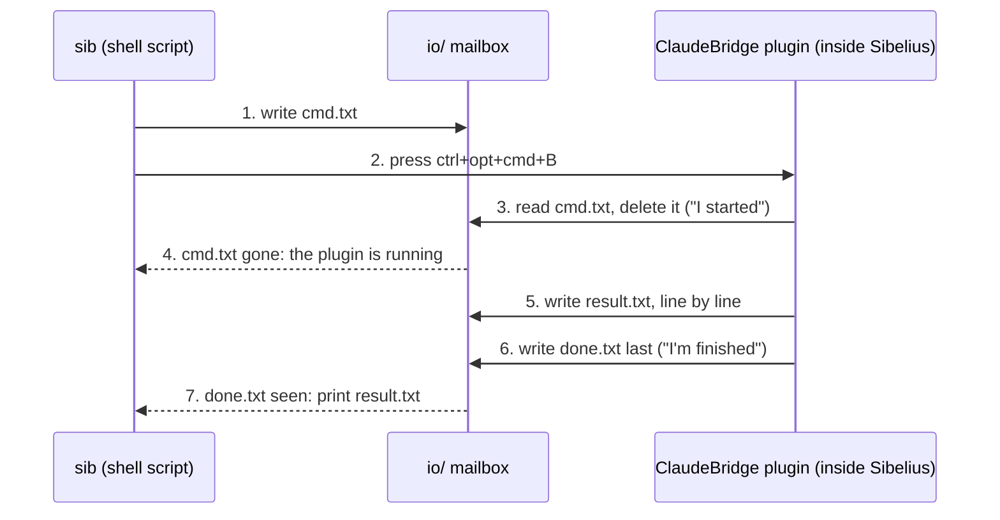
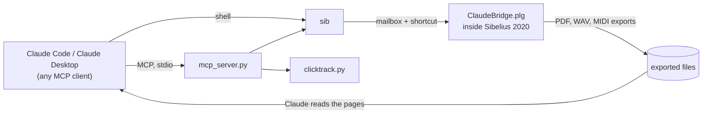
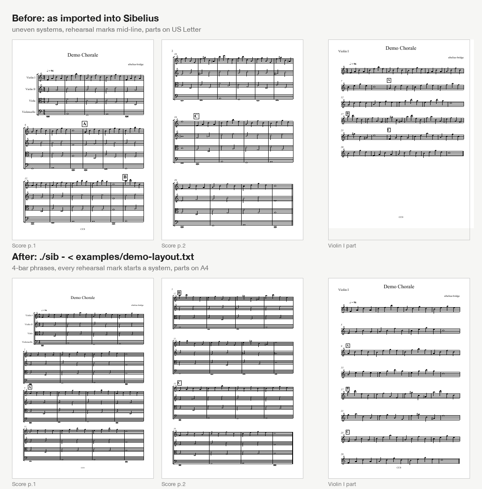
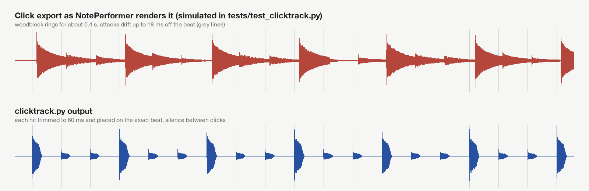

# sibelius-bridge

Claude (or any MCP client) edits scores in **Sibelius 2020**, through a ManuScript plugin, a keyboard shortcut and a folder of text files. No subscription, no Sibelius Connect, no upgrade.


*Right: an unedited screen recording of Sibelius 2020.6. Left: the commands that ran during the recording, with their output. The [full video (mp4, 44 s)](docs/demo.mp4) also shows the click-track tool.*

## Why I built it

I don't like paying for software subscriptions. I own a full, perpetual licence of Sibelius 2020, and it does everything I need as a composer and arranger. Avid added a remote-control API (Sibelius Connect) in Sibelius 2024.3, which for me would mean moving to a subscription or paying for an upgrade.

So I built a bridge that works with the version I already own. A plugin runs inside Sibelius and does the score editing; a small shell script sends it commands; an MCP server exposes both as tools. Claude can then read a score, lay out the parts, fix text, export PDFs, look at the pages and correct what it sees, while I keep working with my own licence.

I have used it on two projects so far: the layout of a 34-part orchestral arrangement (score and all parts, page turns, choir parts with lyrics), and dry click tracks for eight film-music arrangements for a recording session.

## What it does

- **Layout and part preparation.** System and page breaks, Document Setup (page size, staff size, margins), Engraving Rules spacing, Optimize Staff Spacing, multirests, hiding empty staves, moving dynamics clear of lyrics, fixing headers and copyright lines. Every command works on the full score or on any part.
- **Reading the score.** A bar-by-bar map per part: page, system, position in the system, break type, multirest state, number of notes played and rehearsal marks. That is what Claude uses to plan systems and page turns.
- **Checking its own work.** It exports the score and parts as PDF, so Claude can look at the rendered pages and fix collisions or cramped systems.
- **Dry click tracks.** `clicktrack.py` turns Sibelius's click export (rendered by NotePerformer) into a click that sits exactly on the beat, with no ring between clicks. See [Click tracks](#click-tracks).

## How it works

A Sibelius 2020 plugin can read and write files, but it cannot listen to a network port, run a timer or be started from outside. The bridge therefore uses a mailbox of three text files and a keyboard shortcut:



If `cmd.txt` is still there after about 5 seconds, `sib` presses the shortcut again (up to 3 times) and then reports that the plugin did not start. So far that has always meant a dialog was open in Sibelius.



The full explanation, including the design decisions and every Sibelius quirk found on the way, is in [docs/how-it-works.md](docs/how-it-works.md).

## Requirements

- **macOS.** The plugin is plain ManuScript, but `sib` uses AppleScript to press the shortcut.
- **Sibelius 2020.6.** Tested with this version only. Other versions with ManuScript dynamic parts (Sibelius 7 and later) will probably work, but I have not tried them.
- **Python 3.9+** for the MCP server (standard library only) and **numpy** for `clicktrack.py`.
- **NotePerformer** only for the click-track workflow (tested with 3.3.2).

## Install

1. Clone the repository and install the plugin:
   ```bash
   git clone https://github.com/carlosrr08/sibelius-bridge.git
   cd sibelius-bridge
   ./sib install
   ```
   Restart Sibelius afterwards. The plugin appears as **Claude Bridge** under Plug-ins.
2. Give it a keyboard shortcut. In Sibelius, open **Preferences > Keyboard Shortcuts**. The built-in feature set is read-only, so click **Add Feature Set** (based on Standard) first. Then choose **Plug-ins > Claude Bridge**, click **Add** and press **ctrl+opt+cmd+B**. A different key works too: set `SIB_KEY` and `SIB_MODS` for `sib`.
3. In **System Settings > Privacy & Security**, allow the app that runs `sib` (Terminal, Claude Code, Claude Desktop) under **Accessibility**, so it can press the shortcut, and under **Screen Recording** if Claude should take screenshots.
4. The first run shows "plug-ins cannot be undone". Tick "Don't say this again".
5. Open `examples/demo-chorale.sib` and check the connection:
   ```bash
   ./sib info parts
   ```

## Use it with Claude

**Claude Code.** Register the MCP server:

```bash
claude mcp add sibelius -- python3 /path/to/sibelius-bridge/mcp_server.py
```

You can also start Claude Code inside the repository without MCP: `CLAUDE.md` describes every command, and Claude calls `./sib` directly.

**Claude Desktop** (or any other MCP client): add the server to `claude_desktop_config.json`:

```json
{
  "mcpServers": {
    "sibelius": { "command": "python3", "args": ["/path/to/sibelius-bridge/mcp_server.py"] }
  }
}
```

The server offers two tools: `sibelius` (runs bridge commands in the open score) and `clicktrack` (builds a dry click). Prompts that work well:

- "Lay out the parts of the open score: 4 bars per system following the phrases, page turns only on rests, A4."
- "Export the score and every part as PDF into ~/Desktop/review and check them for collisions."
- "The choir parts have dynamics colliding with the lyrics. Fix them."

`layout-rules.md` holds the engraving rules Claude checks against (paper, staff sizes, page turns, systems, multirests). Edit it to match your house style.

## Try it on the demo score

`examples/demo-chorale.sib` is a 32-bar string-quartet chorale (original material, CC0), generated by `examples/make_demo_score.py`. As imported, its systems are uneven, the rehearsal marks fall in the middle of systems and the parts are on US Letter. One batch of commands fixes that:

```bash
./sib - < examples/demo-layout.txt
```



## Command reference

One command per argument (or per line on stdin), fields separated by `|`. `P` is a part index from `parts` (0 is the full score). Bars are internal bar numbers; ranges look like `4,8,12` or `1-40`.

| Command | What it does |
|---|---|
| `info` | title, file, bar, staff and part counts |
| `parts` | index, name, staves, pages, staff size, page size, multirests for every part |
| `staves\|P` | staff numbers and names |
| `map\|P[\|from\|to]` | per bar: page, system, position, break, multirest, notes played, rehearsal mark |
| `break\|P\|bars\|type` | `system`, `page`, `none`, `NotEndOfSystem`, `MiddleOfSystem`, `MiddleOfPage`, `SpecialPageBreak` |
| `setup\|P[\|Key=val,...]` | read or set Document Setup in mm: `PageSize`, `Orientation`, `PageWidth`, `PageHeight`, `StaffSize`, margins |
| `rules\|P[\|Key=val,...]` | Engraving Rules in spaces: `SpacesBetweenStaves`, `SpacesBetweenSystems`, `StaffJustificationPercentage`, ... |
| `optimize\|P[\|from\|to]` | Layout > Optimize Staff Spacing |
| `resetspace\|P`, `resetpos\|P` | Reset Space Above/Below Staff; Reset Position on text, lines and hairpins |
| `multirests\|P\|0/1`, `split\|P\|bars\|0/1` | show multirests; split a multirest at bars |
| `hideempty\|P\|staves\|from\|to`, `showempty\|...` | hide or show empty staves in a bar range |
| `texts\|P` | all system and staff text, with bar and style |
| `settext`, `replacetext`, `deltext`, `scoreinfo` | change text by style or content; File > Score Info fields |
| `dynabove\|P\|textDy\|hairpinDy`, `nudge\|P\|bar\|style\|dx\|dy` | move dynamics and hairpins above vocal staves; move one marking |
| `show\|P` | display a part in Sibelius |
| `pdf\|P\|/abs/path.pdf` | export the score or one part as PDF |
| `save[\|/abs/copy.sib]` | save, or save a numbered copy |

`./sib reload` saves the score, reinstalls the plugin, restarts Sibelius and reopens the same file. Use it after editing `ClaudeBridge.plg`.

## Click tracks

Sibelius can export its click as audio, but with NotePerformer the result cannot be used for a recording session. The woodblock rings for about 0.4 seconds whatever the reverb setting, and each click lands up to 18 ms off the beat.

`clicktrack.py` rebuilds the click from two exports of the same score: the audio export with only the click strip soloed, and a MIDI export for the tempo map. It keeps every click Sibelius plays (accents, beats and the soft subdivision clicks in compound meters), places each one on the exact beat, trims it to 60 ms and checks the file it has written.

```bash
python3 clicktrack.py raw-click.wav score.mid click-dry.wav
```



The figure uses the simulated export from `tests/test_clicktrack.py`, which reproduces the ring, the delay and the jitter I measured on NotePerformer exports of my own scores.

## Limitations

- Sibelius must be the front window while a command runs, and you cannot type into it at the same time.
- Plugin edits cannot be undone in Sibelius. Save a numbered copy before a pass (`save|/path/versions/03.sib`).
- The command set is fixed. A new capability means a new branch in `ClaudeBridge.plg` and a `./sib reload`.
- The reverb preset, the Mixer and the Audio and MIDI export pages have no ManuScript API in Sibelius 2020. Claude drives them through screenshots and the guarded click helpers in `gui/`, which is slower and depends on the screen layout.

## Tests

```bash
python3 tests/test_mcp_server.py   # MCP handshake, tool list, error handling
python3 tests/test_clicktrack.py   # end-to-end click rebuild on a simulated export
```

Neither test needs Sibelius. Both run on every push (GitHub Actions).

## If you have Sibelius 2024.3 or later

Sibelius Connect (a WebSocket on port 1898) can call plugin methods directly. It would replace the keyboard shortcut and let the bridge run while you use Sibelius. The plugin, the command format, the rules file and the click pipeline would stay the same.

## Licence

MIT, see [LICENSE](LICENSE). Sibelius is a trademark of Avid Technology and NotePerformer of Wallander Instruments. This project is not affiliated with either.
